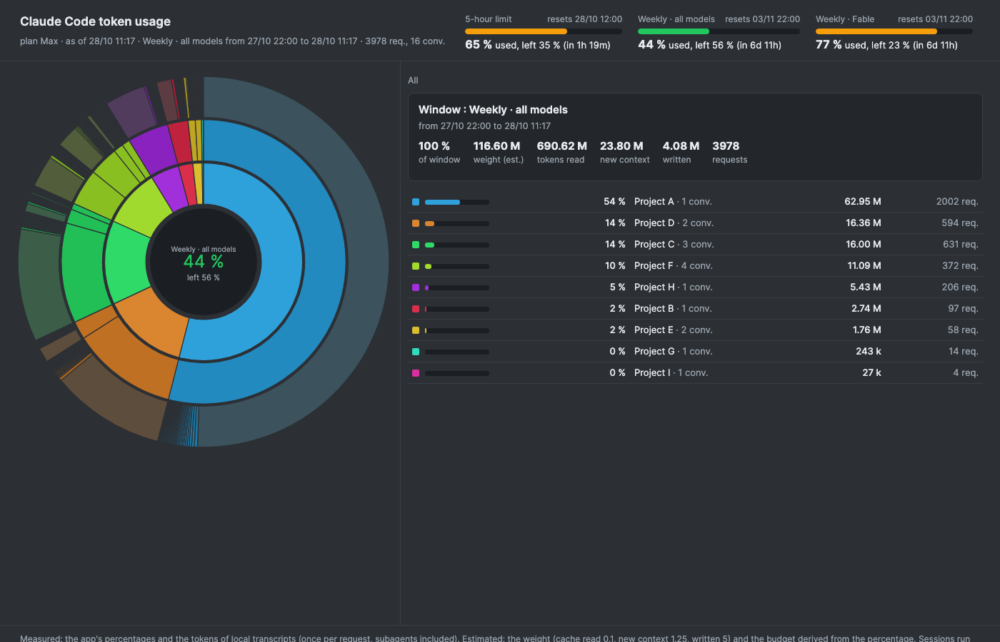

# token-usage

A DaisyDisk-style view of your **Claude Code token usage since the last quota reset**.

Run `/token-usage` and you get one self-contained HTML page:

- the plan quotas (5-hour, weekly, per-model weekly) with what is left and when they reset,
- a sunburst: the quota in the centre, **projects** on the first ring, **conversations** on the second, the heaviest **requests** on the third,
- hover for details, click to zoom, click the centre to go back,
- plus the same summary as text in the chat.



## Install

```
/plugin marketplace add joweber/claude-token-usage
/plugin install token-usage@claude-token-usage
```

Requirements: Python 3.9 or later on the machine running Claude Code. No other dependency, no network access.

## Privacy

The plugin reads only local files: the Claude Code transcripts in `~/.claude/projects` and, in the Claude desktop app, the quota figures the app already shows. It writes one HTML file where you ask. **Nothing is sent anywhere.**

## Measured vs estimated

- **Measured**: the app's quota percentages, and the tokens recorded in the transcripts (new context written to cache, cache reads, direct input, output), counted once per model request, subagents included.
- **Estimated**: the "weight" (a cost-equivalent: cache read 0.1, new context 1.25, output 5, direct 1) and the window budget derived from the app's percentage. The app never exposes the limit in tokens.
- Transcripts cover the current machine only. Sessions on claude.ai, in the cloud or on another computer count toward your quota but are not in the rings.

## Command line

```
python3 skills/token-usage/scripts/token_usage.py [--usage usage.json] [--window weekly|model|5h]
        [--since 7d|24h|ISO] [--top 10] [--actions 30] [--project NAME] [--conversation ID]
        [--html page.html] [--json out.json] [--lang en|fr]
```

`usage.json` is the output of the desktop app's `get_usage` tool. Without it, `--since` sets the window and the page has no quota gauges.

## License

MIT.
